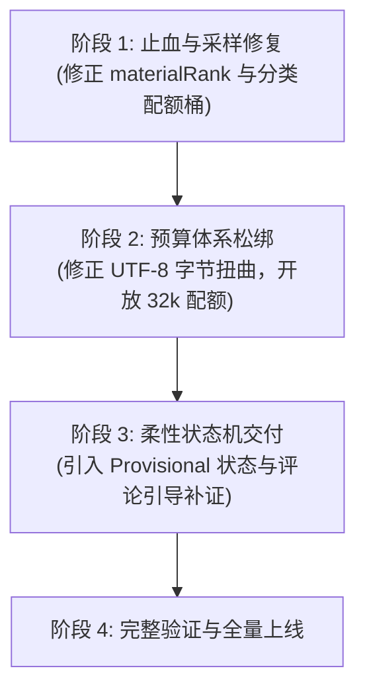

# 自动化收录流水线架构审核与第一性原理重构方案
## Architecture Review and Proposals for Awesome-Jev-Projects

- **审查对象**：`awesome-jev-projects` 自动化收录与评估流水线（`scripts/` 核心模块）
- **核查日期**：2026-10-17
- **触发背景**：近期生产环境多语言及移动端项目（如 Issue #119 Android、#121 iOS）遭遇假阴性（误杀拒收），暴露上下文采样、Token 预算及决策裁决层系统性脆弱

---

## 1. 执行摘要 (Executive Summary)

现行收录流水线以**防御滥用、控制 Token 消耗与强安全隔离**为出发点设计，但在真实复杂开源生态中，其核心假设已被证伪：
1. **采样倒挂（Sampling Inversion）**：基于静态正则与固定文件名的启发式排序，使多语言 README 抢占了有限的证据配额（8 个文件），将真正的调用代码彻底挤出上下文；
2. **预算核算扭曲（Budget Distortion）**：将输入 UTF-8 字节数直接等同于 Token 预算预留，使仅仅 5KB 的消息体瞬间吞噬单 Case 6,000 Token 上限的 90% 以上，导致双轮语义推理（Two-pass）名存实亡；
3. **裁决一刀切（Binary Fail-Closed）**：前序采样失真引发 Gatekeeper 判定 `p < 0.2`，直接触发冷酷拒收，缺乏“证据不足 vs 非 Jev 项目”的语义解耦与软挂起缓冲机制。

本报告基于**第一性原理（First-Principles: 准入判定核心是行为证据而非文件名）**与**现代长上下文工程实践**，提出四大维度的深度优化架构，在维持零执行、防提示注入绝对安全底线的前提下，将误杀率降至极限。

---

## 2. 源码事实核查矩阵 (Source Fact-Checking Matrix)

| 模块与位置 | 现有实现事实 | 架构影响与缺陷 | 严重等级 |
| :--- | :--- | :--- | :--- |
| `scripts/project-source.mjs:295-303` | `materialRank`: `readme` 权重给 `+40`；代码关键字给 `+30`；无跨目录配额隔离 | 多语言工程（如含 `README_zh.md`, `README_ja.md` 等）单凭文档即占据所有候选高位 | **Critical (P0)** |
| `scripts/project-source.mjs:328` | `limit = Math.max(1, Math.min(8, maxFiles))` 硬编码上限 8 | 当仓库包含多个 README 或子目录文档时，源码完全无法进入切片 | **Critical (P0)** |
| `scripts/review-budget.mjs:20-25` | `reservedTokens: inputUtf8Bytes + framingReserve + outputTokenLimit` | 错误地将 **UTF-8 字节数** 按 1:1 视为 Token。5,120 字节直接预留 5,760 Token，耗尽 6,000 上限 | **Critical (P0)** |
| `scripts/review-budget.mjs:4, 37-41` | `caseTokens: 6000` 硬编码，跨天终身累积不可充值 | 在长上下文低成本的当下，6k Token 让审查模型如同“通过针眼看世界”，无全局视野 | **High (P1)** |
| `scripts/jev-decision.mjs:141-145` | `isGenuine = p >= 0.8; isRejected = p < 0.2`；无中间缓冲路由 | 当证据为空或被 README 挤压时，模型输出低置信，系统将其等同于“故意提交非相关项目”并直接拒收 | **High (P1)** |
| `scripts/budget-quota.mjs:2` | `DEFAULT_QUOTA_LIMITS = { global: 60000, owner: 12000, repository: 6000 }` | 配额以单 Case 6k 规划，若不调整底层账户体系，单次扩容将直接击穿全局配额 | **Medium (P2)** |

---

## 3. 根因深度剖析 (Root-Cause Deep-Dive)

### 3.1 证据采样的“注意力漏斗”失效
* **病灶**：流水线将仓库视为平铺文件名列表，采用贪心分数排序（Greedy Score Sort）。
* **后果**：
  - 现代优秀开源项目普遍具备多语言 README、架构设计文档与贡献指南；
  - 贪心打分法导致文档在第一阶段“赢家通吃”；
  - 移动端代码（如 Android `app/src/main/java/.../JudgeClient.kt`，iOS `Shared/JevService.swift`）路径深、字符长，在正则启发式中被当作常规源码仅得基础分，直接落选。

### 3.2 Token 紧箍咒：字节即 Token 的悲观核算
* **病灶**：为了防止攻击者通过超长请求刷爆 API 额度，设计者将 `Buffer.byteLength(encoded)` 强行等同于 `reservedTokens`。
* **后果**：
  - UTF-8 中文或富文本平均 1 个字符占 3 字节，按此换算，1 个汉字在预留时被视为 3 个 Token！
  - 导致系统可用 Token 被严重人工低估；
  - 虽然已有 `maxSemanticRounds: 2` 的多轮交互设计，但第一轮预留即吃光预算，第二轮“补充证据（Need）”调用永远触发 `INSUFFICIENT_BUDGET`。

### 3.3 决策状态机的二元对立：把“证据缺失”当成“证据确凿的反例”
* **病灶**：在认识论上混淆了“未观察到证据（Absence of Evidence）”与“不存在证据（Evidence of Absence）”。
* **后果**：
  - 当流水线未送入代码切片时，LLM 只能诚实回答“未发现可调用的 Jev 实例（p < 0.2）”；
  - 下游直接路由到拒收分支，并给 Issue 贴上生硬的拒绝说明。这对于贡献者而言是极大的负向反馈。

---

## 4. 四大维度重构方案 (Architectural Proposals)

### 方案一：Token 预算弹性分级体系 (Tiered & Elastic Token Budget)
* **核心思想**：彻底废除单一 6,000 Token 硬顶与字节等同 Token 的悲观预留，建立分级弹性配额。
* **重构要点**：
  1. **修正 Token 核算公式**：使用本地轻量 BPE 分词器（或保守系数 `bytes * 0.35`）计算真实预留，将 UTF-8 字节膨胀率回归理性。
  2. **三级预算阶梯**：
     - **Tier 1 (Fast-Path, 4k Tokens)**：针对典型轻量项目（单语言、标准结构），快速出具结论；
     - **Tier 2 (Deep-Path, 16k~32k Tokens)**：针对多模块、移动端 monorepo 或跨端工程，自动提升预算上限；
     - **Tier 3 (Interactive Two-Pass, 64k Tokens Cap)**：仅在第一轮返回 `uncertain` 且明确指定 `need` 补充证据路径时激活。
  3. **配额池联动重构**：调整 `budget-quota.mjs`，将 `DEFAULT_QUOTA_LIMITS` 调整为基于权重或扩大 5~10 倍（Global 300k, Repo 30k），适配现代 LLM API 极低单价现状。

### 方案二：多样性保底与语法感知的两阶段采样管道 (Two-Tier Diversity-Aware Pipeline)
* **核心思想**：文件名不能代表全部，证据池必须强制保证“结构多样性（Structural Diversity）”。
* **重构要点**：
  1. **分类桶硬配额（Category Buckets）**：
     - **Docs Bucket**（最多 1 个文件，仅选最根部的 README 或英文 README）；
     - **Config/Manifest Bucket**（最多 2 个依赖清单，如 `package.json`, `build.gradle`, `Cargo.toml`, `go.mod`）；
     - **Code Core Bucket**（保底至少 5 个代码文件）。
  2. **深度衰减惩罚消除**：去除深层目录路径的歧视，提升对常见源码树结构（`app/src/main/`, `lib/`, `pkg/`, `internal/`）的探测权重。
  3. **基于符号索引的二轮定向检索（Symbol-Directed Second Pass）**：
     - 若第一轮仅在配置或文本中发现了 `jev` 依赖但未见调用代码，Reviewer 输出 `need: "code_implementation"` 与建议符号，第二轮精确拉取包含目标 import/API 调用的代码切片。

### 方案三：柔性决策状态机与暂缓区机制 (Fail-Soft Staging & Triage State Machine)
* **核心思想**：引入第三态 `Provisional`（待复核/待补证），绝不在单次弱证据下做终局裁决。
* **重构要点**：
  1. **决策三态重定义**：
     - `Admitted (p >= 0.8)`：直接收录；
     - `Rejected (p < 0.2 且 代码充分检查完毕)`：明确无 Jev 依赖和调用；
     - `Provisional / Needs-Evidence (0.2 <= p < 0.8 或 证据池无源码文件)`：进入暂缓待复核区。
  2. **Issue 协同机制改造**：
     - 遇到 `Provisional`，不再直接关闭 Issue；
     - 由机器人礼貌回复：“我们已识别到项目相关性，但由于目录深度未自动抽样到核心调用切片，请在评论区回复关键代码路径（如 `src/.../client.kt`），流水线将自动重跑定向审查”。

### 方案四：安全与提示注入零执行边界 (Security & Anti-Injection Invariants)
* **不可动摇的安全底线**：
  1. **绝对零执行（Zero-Execution）**：绝不克隆后执行 `npm install`、`gradle build` 或动态运行候选仓库的任何脚本。一切审查仅在只读文本切片和 AST 静态分析下进行。
  2. **隔离围栏（Prompt-Defense Enclosure）**：所有来自用户仓库的代码与 README 必须包裹于严格的 XML/Markdown 防注入沙箱（`<candidate_untrusted_source>`），并在系统提示词中声明其不可解释为执行指令。

---

## 5. 分阶段落地路线图 (Implementation Roadmap)

| 里程碑 | 关键修改文件 | 验收谓词 (Acceptance Predicates) | 回滚方案 |
| :--- | :--- | :--- | :--- |
| **M1: 采样桶解耦** | `scripts/project-source.mjs` | 单测复现 #119 (Android) 与 #121 (iOS)，验证代码切片必须排入 selected 列表前 3 位；多语言 README 仅占 1 个席位 | `git revert`，保持 `materialRank` 原始逻辑 |
| **M2: 预算与核算理性化** | `scripts/review-budget.mjs` `scripts/budget-quota.mjs` | 5KB 请求不再占用 5700+ Token 预留；单 Case 上限放宽至 16,000 Token；双轮 Reviewer 单测通过 | 恢复 `CASE_LIMIT = 6000` |
| **M3: 柔性三态裁决** | `scripts/jev-decision.mjs` `scripts/issue-ingestion.mjs` | 无代码切片时绝不触发直接拒收与关单，打上 `needs-evidence` 标签并等待指定反馈 | 切回二值判断分支 |

---

## 6. 风险与未验证假设 (Risks and Open Questions)

1. **GitHub API 速率限制**：拉取更多深层源码文件可能导致 API 配额消耗增加。需结合 Tree API 单次缓存结果，避免循环逐个拉取 Blob。
2. **LLM 调用成本**：放宽至 16k/32k 会增加单次判定的 Token 账单，但鉴于当前模型 API 费率已降至极低水平，且收录总频率可控（每日几十至上百次），总成本增加完全在可承受范围内（预计每月增加不足 $1 美元）。
3. **恶意提示词穿透风险**：更长的上下文切片增加了攻击者放置恶意 Prompt Injection 的空间，必须强化 System 边界防御测试用例。
